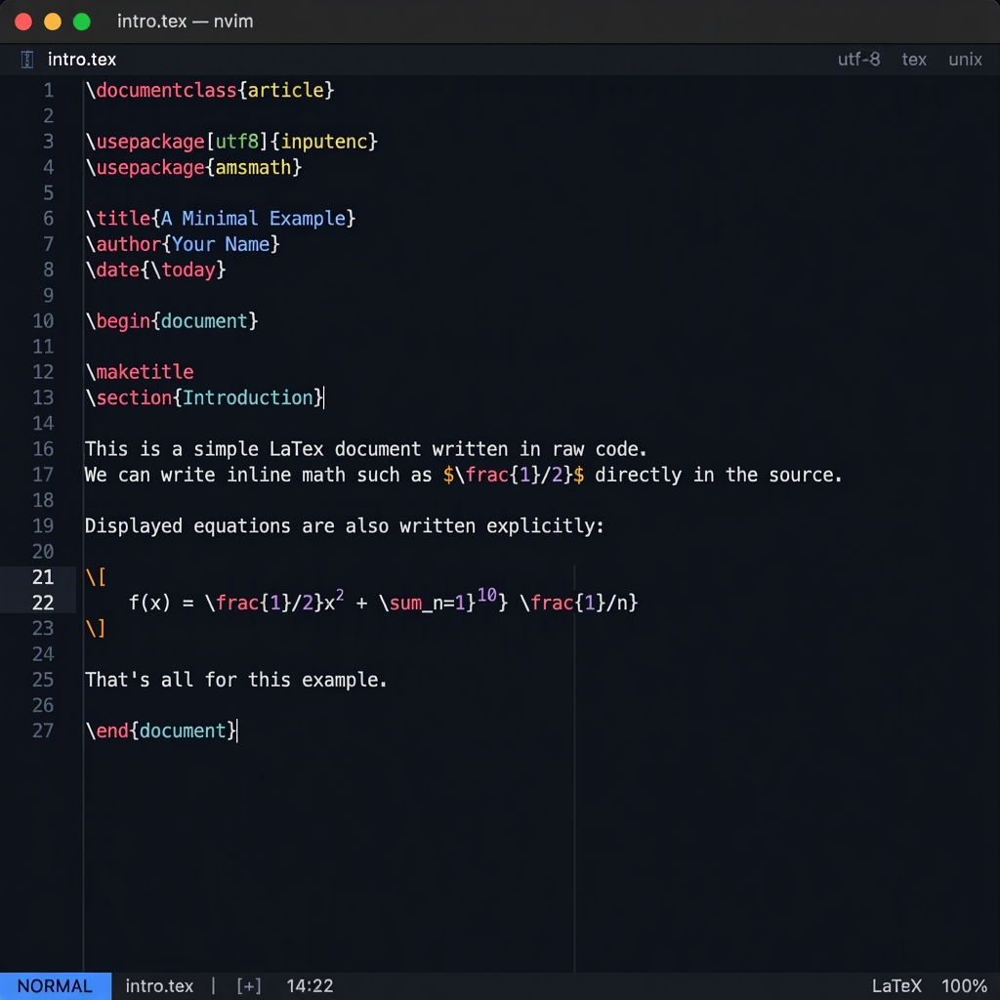
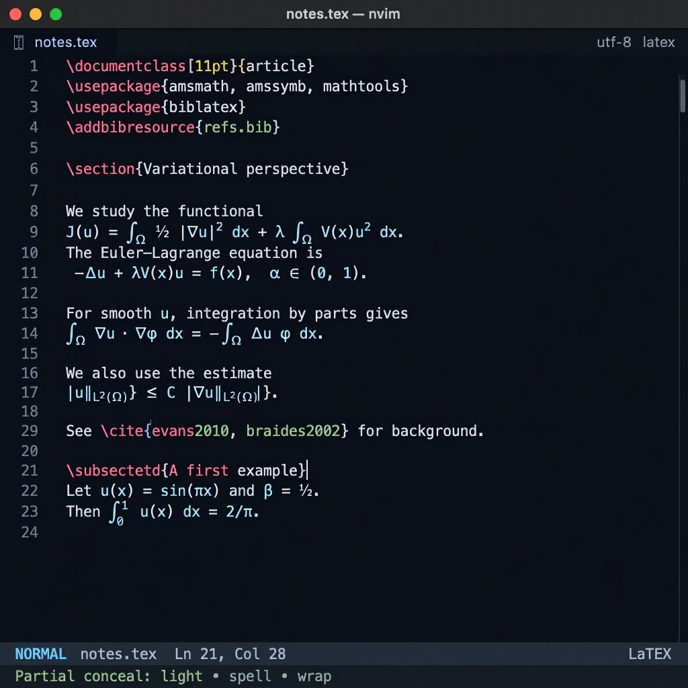

# vimtex-conceal

A Neovim plugin to cycle through three LaTeX syntax concealment levels: **off**, **light**, and **full**.

  
*Raw LaTeX commands are visible. No characters are hidden.*

  
*Greek letters, fractions and math symbols become Unicode glyphs (e.g. α, ½, ∫), but citations and section commands remain raw.*

## Features

- **off** – raw LaTeX commands are displayed as‑is.
- **light** – Greek letters, math symbols and fractions become Unicode glyphs (e.g. `α`, `½`, `∫`).
- **full** – also hides citations, delimiters, styles and spacing.

## Installation

### With lazy.nvim

```lua
{
  "fred73-coding/vimtex-conceal",
  ft = "tex",
  opts = {},   -- optional: you can pass custom conceal levels if you want
}
```

### With packer.nvim

```lua
use "fred73-coding/vimtex-conceal"
```

### Manual (optional)

1. Clone the repo:
   ```bash
   git clone https://github.com/fred73-coding/vimtex-conceal ~/.config/nvim/pack/plugins/start/vimtex-conceal
   ```
2. Ensure `lua/vimtex-conceal/init.lua` is on the rtp (Neovim will auto‑load it).

## Usage

Press `<localleader>lz` (default `\lz`) to toggle the conceal level. A notification appears each time you change the level, showing the current name (`off`, `light`, or `full`).

## License

This project is licensed under the **MIT License**. See the `LICENSE` file for details.

© 2026 fred73-coding